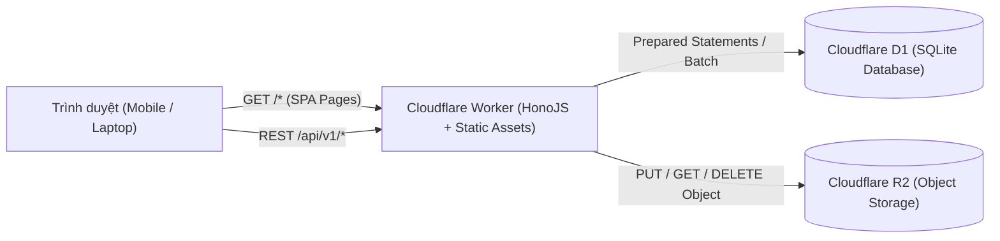

# Kiến Trúc Hệ Thống — MỘC Coffee

## 1. Tổng Quan Kiến Trúc
**MỘC Coffee** được thiết kế theo kiến trúc **Full-Stack Serverless trên nền tảng Cloudflare Edge**, kết hợp:
- **Frontend**: React 19 + TypeScript + Vite + Tailwind CSS v4 + React Router v7 + TanStack Query v5 + React Hook Form + Zod.
- **Backend API**: HonoJS v4 + TypeScript chạy trực tiếp trên **Cloudflare Workers Runtime** (`/api/v1/*`).
- **Database**: **Cloudflare D1** (SQLite phân tán tại Edge) lưu trữ sản phẩm, danh mục, biến thể, đơn hàng, lịch sử trạng thái, biến động tồn kho, phiên đăng nhập và nội dung website.
- **Object Storage**: **Cloudflare R2** lưu trữ hình ảnh sản phẩm, danh mục, banner và phân phối qua endpoint `/api/v1/media/:key` kèm bộ nhớ đệm (`Cache-Control: public, max-age=31536000, immutable`) hoặc Custom Domain.
- **Phân phối hợp nhất (Single-Domain Architecture)**: Sử dụng **Cloudflare Workers Static Assets** (`assets.directory = "./dist/client"`, `not_found_handling = "single-page-application"`). Cả giao diện ReactJS và API `/api/v1/*` đều chạy dưới cùng một tên miền, loại bỏ hoàn toàn độ trễ preflight CORS và cho phép sử dụng cookie xác thực `HttpOnly; SameSite=Lax` an toàn tuyệt đối.



## 2. Luồng Đặt Hàng & Quản Lý Tồn Kho Nhất Quán
1. Khách hàng gửi yêu cầu `POST /api/v1/orders` kèm `idempotency_key` duy nhất cho phiên thanh toán.
2. Backend kiểm tra `idempotency_key` trong bảng `orders` để ngăn chặn tạo đơn trùng khi mạng chập chờn hoặc người dùng bấm nhiều lần.
3. Backend truy vấn lại bảng `products` từ D1 để lấy giá thực tế (`sale_price` hoặc `price`) và tồn kho hiện tại — hoàn toàn không tin tưởng giá từ phía client.
4. Thực hiện trừ tồn kho nguyên tử có điều kiện:
   ```sql
   UPDATE products SET stock = stock - ?, updated_at = datetime('now')
   WHERE id = ? AND is_active = 1 AND stock >= ?
   ```
5. Nếu `meta.changes === 0` (hết hàng do cạnh tranh đồng thời), hệ thống hoàn trả lại tồn kho đã trừ và trả về mã lỗi `409 INSUFFICIENT_STOCK`.
6. Thực thi `DB.batch(...)` để ghi nhận đồng thời:
   - Bản ghi `orders` (trạng thái `pending`)
   - Các dòng `order_items` (snapshot tên, SKU, giá bán tại thời điểm mua)
   - Bản ghi `inventory_movements` (`reason = 'order_placed'`)
   - Bản ghi `order_status_history` (`new_status = 'pending'`)

## 3. Cơ Chế Xác Thực & Bảo Mật Quản Trị
- Mật khẩu quản trị viên được băm bằng thuật toán **PBKDF2-HMAC-SHA256 (100.000 vòng lặp)** với salt ngẫu nhiên 16 byte thông qua **Web Crypto API** chuẩn của Cloudflare Workers.
- Khi đăng nhập thành công (`POST /api/v1/admin/auth/login`), hệ thống sinh chuỗi token ngẫu nhiên 32 byte, chỉ lưu bản băm SHA-256 (`token_hash`) vào bảng `sessions` trong D1 và gửi token gốc về trình duyệt qua cookie `HttpOnly; SameSite=Lax`.
- Không lưu token xác thực trong `localStorage` của trình duyệt.
- Tích hợp bộ giới hạn tần suất (Rate Limiter) chống tấn công dò mật khẩu trên endpoint đăng nhập.
