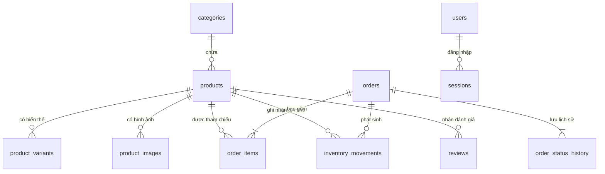

# Thiết Kế Cơ Sở Dữ Liệu Cloudflare D1 — MỘC Coffee

Hệ thống sử dụng **Cloudflare D1 (SQLite)** với 15 bảng dữ liệu có ràng buộc khóa chính, khóa ngoại, ràng buộc duy nhất (`UNIQUE`) và chỉ mục (`INDEX`) tối ưu cho truy vấn thương mại điện tử.

## 1. Sơ Đồ Quan Hệ Bảng (ERD)

## 2. Danh Sách Các Bảng Trong D1

| STT | Tên bảng | Mô tả chức năng | Các cột & Ràng buộc chính |
|---|---|---|---|
| 1 | `users` | Tài khoản quản trị viên | `id` PK, `email` UNIQUE, `password_hash`, `password_salt`, `role`, `is_active` |
| 2 | `sessions` | Phiên đăng nhập Admin | `id` PK, `token_hash` UNIQUE, `user_id` FK -> `users(id)`, `csrf_token`, `expires_at` |
| 3 | `categories` | Danh mục sản phẩm | `id` PK, `name`, `slug` UNIQUE, `description`, `image_url`, `image_key`, `is_active` |
| 4 | `products` | Sản phẩm cà phê | `id` PK, `category_id` FK, `slug` UNIQUE, `sku` UNIQUE, `price` (INT VND), `sale_price`, `stock` (INT) |
| 5 | `product_variants` | Biến thể khối lượng/cỡ xay | `id` PK, `product_id` FK, `sku` UNIQUE, `grind_type`, `weight_grams`, `price`, `stock` |
| 6 | `product_images` | Thư viện ảnh phụ của SP | `id` PK, `product_id` FK, `image_url`, `image_key` (R2 object key), `is_primary` |
| 7 | `orders` | Đơn đặt hàng của khách | `id` PK, `order_code` UNIQUE, `idempotency_key` UNIQUE, `status`, `subtotal`, `shipping_fee`, `total` |
| 8 | `order_items` | Chi tiết từng dòng đơn hàng | `id` PK, `order_id` FK, `product_id` FK, `product_name_snapshot`, `sku_snapshot`, `unit_price`, `quantity` |
| 9 | `inventory_movements` | Nhật ký xuất/nhập/hoàn kho | `id` PK, `product_id` FK, `order_id` FK, `change_amount`, `previous_stock`, `new_stock`, `reason` |
| 10 | `order_status_history` | Lịch sử chuyển trạng thái đơn | `id` PK, `order_id` FK, `previous_status`, `new_status`, `note`, `changed_by`, `created_at` |
| 11 | `banners` | Banner Hero trang chủ | `id` PK, `title`, `subtitle`, `eyebrow`, `cta_primary_text`, `image_url`, `image_key` |
| 12 | `site_content` | Nội dung tĩnh & cấu hình phí ship | `id` PK, `section_key` UNIQUE, `title`, `subtitle`, `content_json` |
| 13 | `newsletter_subscribers` | Danh sách email nhận bản tin | `id` PK, `email` UNIQUE, `status`, `source`, `created_at` |
| 14 | `reviews` | Đánh giá sản phẩm | `id` PK, `product_id` FK, `author_name`, `rating` (1..5), `is_verified_purchase`, `is_sample_dev` |
| 15 | `blog_posts` | Bài viết cẩm nang cà phê | `id` PK, `title`, `slug` UNIQUE, `excerpt`, `content`, `cover_image`, `is_published` |

## 3. Quy Tắc Chuyển Trạng Thái Đơn Hàng (`orders.status`)
- `pending` (Chờ xác nhận) → `confirmed`, `processing`, `cancelled`
- `confirmed` (Đã xác nhận) → `processing`, `shipped`, `cancelled`
- `processing` (Đang chuẩn bị hàng) → `shipped`, `cancelled`
- `shipped` (Đang giao hàng) → `delivered`, `cancelled`
- `delivered` (Đã giao thành công) → *(Trạng thái cuối, không cho phép chuyển ngược)*
- `cancelled` (Đã hủy) → *(Trạng thái cuối, tự động hoàn lại số lượng tồn kho và ghi nhận vào `inventory_movements`)*
